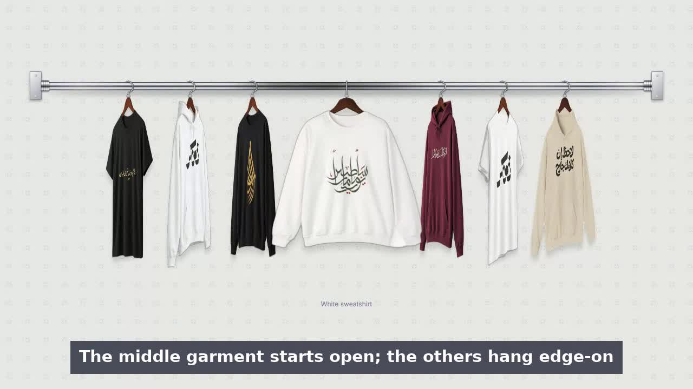
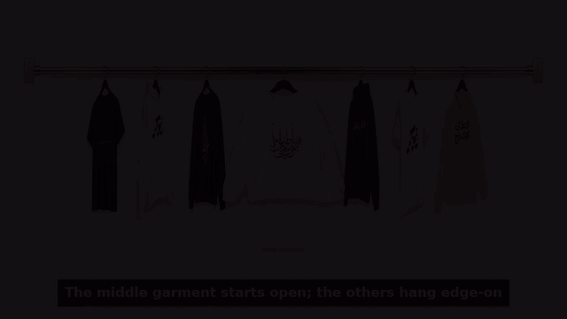

# Shopify Clothing Banner

A homepage banner for clothing stores: garments hang from a chrome rail, and they move the way clothes on hangers really do. Hover (or drag a finger) across the rack and the garment under the pointer swings round to face you while its neighbours slide aside, overshoot a little, and sway.

[](docs/how-it-works.mp4)



It is one React component and one stylesheet. No animation library, no Tailwind, no Shopify SDK: it takes a list of garments and draws the rack. It was built for a Shopify storefront ([shirtat.co](https://shirtat.co)), which is where the name comes from, and it works with any data source.

## What you get

- **Real garment photos, real hanger motion.** Springs drive each garment's turn and the rack's spacing; a pendulum drives the swing when neighbours push it.
- **One garment is always selected.** The middle garment starts open (it is open in the server-rendered HTML too, so nothing jumps on load) and the rack returns to it when the pointer leaves.
- **Desktop and touch.** Hover with a mouse. On touch screens, drag a finger across the rack to browse and tap to select. A drag never selects.
- **Fits any width.** Sizing follows the banner's own width, so it works in a narrow column as well as full-bleed. On phones the whole rod fits the screen, with no sideways scrolling.
- **Right-to-left.** `rtl` mirrors the order and the swing.
- **Accessible.** Every garment is a real button for keyboard users, motion respects `prefers-reduced-motion`, and focus opens the garment just like hover does.
- **Light on the page.** Shadows are baked into the photos instead of live CSS filters, hidden poses are not painted, layers are promoted only while something moves, the photos you can see load first and the rest follow when the browser is idle.

## Quick start

Requires React 18 or newer. The easiest way to use it is to copy two files into your project:

```
src/clothing-rack.tsx
src/clothing-rack.css
```

```tsx
import { ClothingRack, type RackItem } from "./clothing-rack";

const items: RackItem[] = [
  { id: "black-tee", name: "Black tee", image: "/rack/black-tee-front.webp", sideImage: "/rack/black-tee-side.webp", href: "/products/black-tee" },
  { id: "white-hoodie", name: "White hoodie", image: "/rack/white-hoodie-front.webp", sideImage: "/rack/white-hoodie-side.webp", href: "/products/white-hoodie" },
  // ...five to nine garments look best
];

export function Hero() {
  return <ClothingRack items={items} />;
}
```

Garments with an `href` navigate there when selected. Pass `onSelect` to do something else, such as opening a quick view.

```tsx
<ClothingRack items={items} onSelect={(index, item) => openQuickView(item.id)} />
```

You can also install it straight from GitHub and import from the package (`npm install github:moeghashim/shopify-clothing-banner`). The package ships TypeScript source, so frameworks that compile dependencies need to be told to (in Next.js, add it to `transpilePackages`).

### Next.js

The component file starts with `"use client"`. To use `next/image`, pass `renderImage`:

```tsx
import Image from "next/image";

<ClothingRack
  items={items}
  renderImage={({ src, priority }) => (
    <Image alt="" className="cr-img" height={960} priority={priority} sizes="(min-width: 768px) 300px, 160px" src={src} width={800} />
  )}
/>
```

## Props

| Prop | Type | Default | |
| --- | --- | --- | --- |
| `items` | `RackItem[]` | required | The garments, left to right. |
| `rtl` | `boolean` | `false` | Hang the first item on the right and mirror the swing. |
| `disabled` | `boolean` | `false` | Ignore hover and touch while something else (a dialog) is in front. |
| `onSelect` | `(index, item) => void` | navigates to `item.href` | Called on click or tap. |
| `tapHint` | `string` | `"Tap to view"` | Hint shown beside the name on touch devices. |
| `renderImage` | `({ src, priority }) => ReactNode` | plain `` | Swap in your framework's image component. |
| `maxGarmentWidth` | `number` | `300` | Largest garment width in px on wide containers. |
| `className` | `string` | | Added to the outer element. |

`RackItem`:

| Field | Type | |
| --- | --- | --- |
| `id` | `string` | Stable key. |
| `name` | `string` | Shown under the rack while selected; also the garment's accessible name. |
| `image` | `string` | Front-facing photo (see below). |
| `sideImage` | `string?` | The same garment turned away from the camera. If omitted, the front photo is turned edge-on. |
| `href` | `string?` | Where a selection goes when `onSelect` is not set. |

## Theming

Set these on the banner or any ancestor:

```css
.my-hero {
  --cr-bg: #e6e6e2;  /* wall colour */
  --cr-ink: #3d4670; /* caption colour */
}
```

The pegboard pattern, rod and hardware live in `clothing-rack.css` and are easy to change.

## Using it with Shopify

Product photos on a Shopify store are usually flat-lay or model shots, so they have no hanger. The rack needs garments photographed (or prepared) on a hanger, which you can keep next to each product. One clean way is two file metafields on the product, for example `custom.rack_front` and `custom.rack_side`:

```graphql
query RackProducts($collection: String!) {
  collection(handle: $collection) {
    products(first: 9) {
      nodes {
        handle
        title
        front: metafield(namespace: "custom", key: "rack_front") {
          reference { ... on MediaImage { image { url } } }
        }
        side: metafield(namespace: "custom", key: "rack_side") {
          reference { ... on MediaImage { image { url } } }
        }
      }
    }
  }
}
```

```ts
const items: RackItem[] = collection.products.nodes
  .filter((p) => p.front?.reference?.image)
  .map((p) => ({
    id: p.handle,
    name: p.title,
    image: p.front!.reference!.image.url,
    sideImage: p.side?.reference?.image.url,
    href: `/products/${p.handle}`,
  }));
```

Prices, availability and everything else about a product should still come from Shopify; the rack only draws the photos and names.

## Preparing your photos

The rack expects each photo to be:

- **800 × 960 px**, transparent background (WebP or PNG)
- the garment **on a light-wood hanger**, front-facing for `image`, turned away from the camera for `sideImage`
- the **hanger apex at (400, 92)** so every garment hangs from the same point
- **no photographed hook**: the rack draws a chrome hook that loops over the rod
- a **soft shadow baked in** (cheaper than a live CSS filter)

`tools/prepare-garment.py` does the last four for you from a photo with a transparent or plain white background:

```bash
pip install pillow numpy
python tools/prepare-garment.py tee.png tee-front.webp                  # mahogany hanger
python tools/prepare-garment.py tee.png tee-front.webp --hanger none    # keep the hanger colour
python tools/prepare-garment.py tee.png tee-front.webp --hanger "#5a2d1c"
python tools/prepare-garment.py odd.png out.webp --apex-x 512 --apex-y 140   # if the hanger is not found
```

It finds the wooden hanger by colour, so it works best with light-wood hangers; use `--apex-x/--apex-y` for anything else. Always look at the result before you ship it.

## How it works

Nothing animates with CSS transitions. A small simulation runs on `requestAnimationFrame` only while something is moving, then stops.

1. **Layout spring.** Each garment has an "openness" from 0 (hanging edge-on) to 1 (facing you). Openness drives how much room the garment takes, so the others slide aside continuously instead of jumping between slots.
2. **Spin spring.** The turn of each garment about its hanger is a second spring with less damping, so it overshoots front-on by a few degrees and settles, the way a hanger twists. The side and front photos cross-fade across the turn, so there is no pop.
3. **Pendulum.** Each garment hangs from the rod at its hook. When a neighbour's slot changes, the hook point accelerates, and a damped pendulum turns that acceleration into a swing. The hem lags the turn slightly (a small skew).
4. **Pointer.** Hover and drag are hit-tested against the live positions of the garments, so the one under your finger is the one that opens. Pointer speed adds a small push when you brush from one garment to the next.
5. **Hook and rod.** The hook is an SVG whose loop opens as the garment turns edge-on. The far side of the loop is clipped by the rod's edge so it passes behind the bar.

The starting state (middle garment open, the rest edge-on) is written into the server-rendered markup with the same CSS-variable maths the simulation uses, so hydration changes nothing on screen.

## Browser support

Current browsers: it uses container queries, the individual `translate` property and `color-mix()`, so roughly Chrome and Edge 111+, Safari 16.2+ and Firefox 113+.

## Development

```bash
npm install
npm run dev         # demo at http://localhost:5173   (add ?clean for a bare rack)
npm run typecheck
npm run build       # builds the demo to dist/
```

The demo is in `demo/`; the component is in `src/`.

### Re-recording the demo video

`docs/how-it-works.mp4` is recorded from the demo itself: `video/record.mjs` drives it with a mouse (desktop) and real touch events (phone) using Playwright, and `video/compose.py` cuts the clips together with captions using ffmpeg.

```bash
npm run dev                      # in one terminal
npx playwright install chromium  # once
node video/record.mjs            # records to video/out/ (add --url to point at another page)
python3 video/compose.py         # needs ffmpeg with drawtext; writes docs/how-it-works.{mp4,gif}, docs/poster.jpg
```

## Project layout

```
src/clothing-rack.tsx   the component and the physics
src/clothing-rack.css   styles and theming variables
demo/                   Vite demo app and sample garments
tools/prepare-garment.py  photo preparation
video/                  demo video scripts
docs/                   demo video, GIF and poster
```

## Licence

The code is [MIT](LICENSE).

The sample garment photos in `demo/public/garments/` are the property of [Shirtat](https://shirtat.co) and are included only so the demo runs. Replace them with your own before you use the banner in a project.
